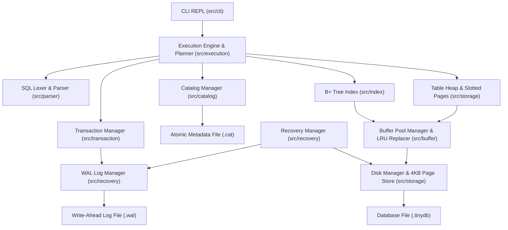

# TinyDB v1.0 Architecture

> **Status:** Architectural Blueprint (Bootstrap initialized; subsystems will be implemented incrementally from `DAY-001` through `DAY-284`).

TinyDB is a layered, disk-oriented relational database engine written in C++20. Each layer communicates through explicit interfaces and enforces strict bounds checking, clear ownership, and explicit binary serialization.

---

## System Architecture Diagram

---

## Layered Module Responsibilities

| Layer | Directory | Responsibility |
|---|---|---|
| **Core Foundations** | `src/core` | Fixed-width IDs (`PageId`, `FrameId`, `TxnId`, `Lsn`), `Status` / `Result<T>`, endian-explicit binary read/write, CRC32 checksums, RAII `FileHandle`. |
| **Storage Engine** | `src/storage` | Fixed 4096-byte page layout, `DiskManager` (allocate, read, write, flush, free-list), `Tuple` serialization, `SlottedPage` layout, `TableHeap` multi-page chains. |
| **Buffer Pool** | `src/buffer` | `PageFrame` cache, `page_table_` mappings, pin counts, sticky dirty tracking, `LRUReplacer`, RAII `PageGuard`s, no-steal pin protection. |
| **Catalog** | `src/catalog` | Table/column/index schemas, monotonic IDs, atomic temp-file + `fsync` + `rename` persistence in a separate versioned metadata file. |
| **Indexing** | `src/index` | Disk-backed B+ Tree over `int64_t` keys mapped to `RowID`, composite `(key, RowID)` ordering for duplicate keys, structural invariant validator. |
| **SQL Frontend** | `src/parser` | Line/column-aware `Lexer`, recursive-descent `Parser`, AST hierarchy for the supported SQL subset, strict input & recursion limits. |
| **Query Engine & CLI** | `src/execution`, `src/cli` | Volcano pull-based iterators (`SeqScan`, `IndexScan`, `Filter`, `Projection`, `Insert`, `Update`, `Delete`), rule-based index planner, tabular CLI REPL + dot-commands. |
| **Transactions & WAL** | `src/transaction`, `src/recovery` | Single active transaction, in-memory before-images for runtime `ROLLBACK`, no-steal buffer pool rule, durable redo-only WAL `COMMIT`, startup `RecoveryManager`. |

---

## End-to-End Query Lifecycle (Target v1.0)

1. **Input & Parsing:** User submits SQL or dot-commands in `tinydb` CLI. `Lexer` produces `Token`s with source positions; `Parser` produces an AST or syntax diagnostic.
2. **Planning & Validation:** `Planner` looks up table/index schemas via `CatalogManager`, validates types and bounds, and selects either `IndexScanExecutor` or `SequentialScanExecutor`.
3. **Transaction Context:** `ExecutionEngine` ensures an active `Transaction` (explicit via `BEGIN` or implicit auto-commit).
4. **Pull Execution:** Top-level executor pulls `Tuple`s lazily from child operators.
5. **Buffer & Storage Access:** Table and index pages are fetched via `BufferPoolManager` returning RAII `PageGuard`s. Cache misses invoke `DiskManager::ReadPage`.
6. **Durability & Recovery:** On `COMMIT`, after-images and `COMMIT` record are appended to the WAL and `fsync`ed before reporting success; uncommitted pages remain un-flushed (no-steal). On restart after crash, `RecoveryManager` replays committed WAL records idempotently using `PageHeader::lsn`.
